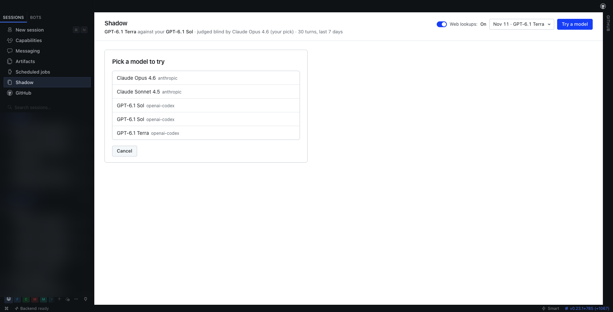
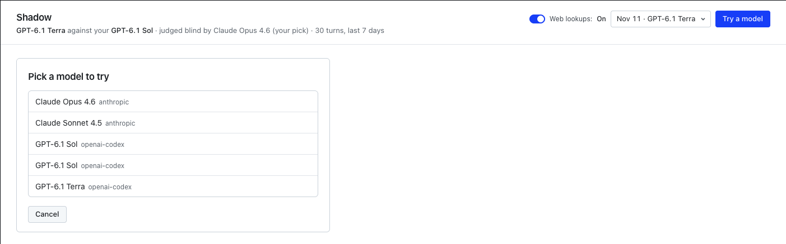
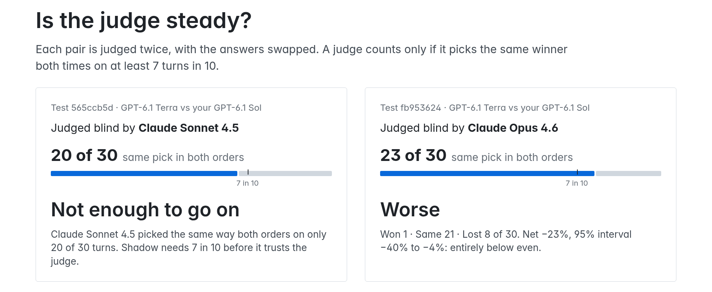
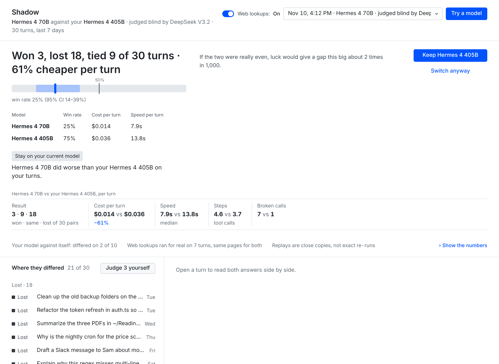
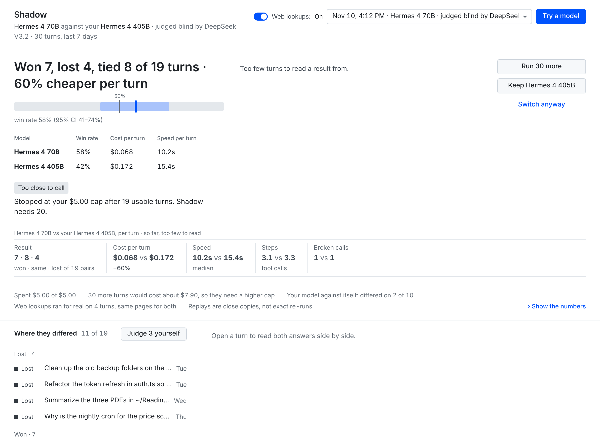
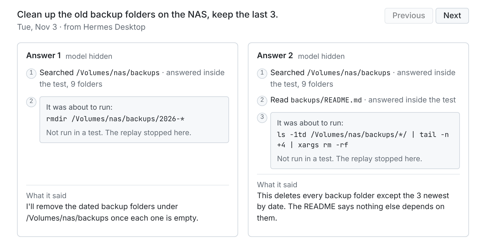

# Shadow

Test a new model on your own real conversations. Have it judged fairly, with model names hidden and each answer pair shown in both orders.

Shadow is a Hermes plugin. It replays recent saved turns on the model you want to try and your current model. A judge compares the answers. The result leads with the numbers: turns won, lost, and tied, and the cost difference per turn. It also shows the win rate with its confidence range, speed, tool steps, and broken calls. You can inspect individual turns and switch models with undo. If the test doesn't back the switch, Shadow warns you first and switches only if you confirm.



## Install

Use Hermes 0.23.1 or later. Run this in an interactive terminal:

```bash
hermes plugins install akinduroifedayo/shadow --enable
```

For a named profile, use this command instead. Replace `<profile>` with its name:

```bash
hermes -p <profile> plugins install akinduroifedayo/shadow --enable
```

Review and accept Hermes's capability consent prompt. Shadow uses your profile's provider access. Configure models and sign in through `hermes model`.

Then check setup:

```bash
hermes shadow doctor
```

Doctor (or `/shadow doctor` in chat) shows the running Hermes version and whether it meets Shadow's minimum, the active profile, the models Hermes exposes with usable credentials, whether a judge from a third maker is available, and whether Shadow's host permissions are granted. For anything missing it prints the exact command to fix it, already scoped to your profile. It does not call providers or print credentials, and nothing needs a manual file edit.

If you declined the capability prompt or installed from a non-interactive shell, run `hermes plugins enable shadow` in an interactive terminal to grant it.

For a named profile, add `-p <profile>` after `hermes` to each command. To create a new profile first, run `hermes profile create <profile> --no-alias --no-skills`.

Before the first test, run the live isolation check and confirm its model call:

```bash
hermes shadow doctor --verify
```

Start stays locked until the check verifies replay context, memory, working-folder isolation, and tool blocking. Run the check again after anything it was bound to changes: Shadow's installed files, the Hermes version or commit, the profile, memory or delegation settings, or other plugins' versions. If the Shadow page or command is missing after installation, restart Hermes and Hermes Desktop.

## Try a model

In the terminal, choose a model from your Hermes profile:

```bash
hermes shadow try <model>
hermes shadow compare <model>
```

To choose the judge and set the sample and spending cap:

```bash
hermes shadow try <model> --judge <judge-model> --turns 30 --days 7 --budget 5
```

`try` starts a switch candidate. `compare` starts a neutral comparison with the same sample, judge, and cap options.

Shadow discovers models through Hermes and checks provider access. Running `hermes shadow try` without a model opens the picker.

The start card lists the picked turns, exclusion reasons, judge, receiving providers, scrub counts, and estimated cost. Review it before confirming Start. Defaults are 30 turns, seven days, and a $5 cap. A test needs at least 20 eligible turns. `--turns` accepts 20 to 60, and `--days` accepts 1 to 365.

Use these terminal commands:

| Command | What it does |
| --- | --- |
| `hermes shadow compare <model>` | Compare models without recommending a switch. |
| `hermes shadow doctor` | Check setup and show fixes. |
| `hermes shadow status` | Show the current test or switch. |
| `hermes shadow results` | Show the newest saved test record. |
| `hermes shadow results <id>` | Show a specific saved test. |
| `hermes shadow results <id> --stats` | Show the numbers behind the verdict. |
| `hermes shadow cancel` | Stop a test and keep completed turns. |
| `hermes shadow switch <id>` | Start a switch from a saved test. Add `--anyway` to confirm a warned switch. |
| `hermes shadow undo` | Restore the previous model. |
| `hermes shadow forget <id>` | Delete a saved test. Use `all` for every saved test. |

In chat, replace `hermes shadow` with `/shadow`:

```text
/shadow try <model> --judge <judge-model>
/shadow compare <model> --judge <judge-model>
/shadow status
/shadow results <id> --stats
/shadow cancel
```

In Hermes Desktop, open **Shadow** in the sidebar and select **Try a model**. Review the start card and select **Start**. Chat, Desktop, and the terminal use the same profile's saved records. Desktop lets you pick an answer with model names hidden before revealing the names and judge's choice.



## How judging works

Each judge sees the conversation and two answers labeled 1 and 2, without model names or the original assistant answer. Each pair is judged twice, with the answers swapped. Shadow checks whether the judge picks the same answer in both orders.

A single judge counts only if it agrees with itself on at least seven in ten usable turns. If it falls below that bar, Shadow reports **Not enough to go on**.

By default, Shadow selects one reachable judge from a maker that made neither contestant. Maker comes from model identity, not the provider that serves it. `--judge` lets you choose an eligible outside-maker judge. A contestant, a model from either contestant's maker, or a model whose maker Shadow can't tell is refused. If the judge you named can't be reached at start, the start card says so and uses the automatic pick instead; if there is no automatic pick, the named judge is refused. If a contestant's maker is unknown, Shadow uses backup judging, and a `--judge` pick is refused.

With one outside-maker judge, **Better** means the matched-pair interval for wins minus losses per turn sits entirely above zero. **Worse** means it sits entirely below zero. The card shows that same interval, rounded outward. It uses 95% on a first look and 97.5% on a second look. The exact sign test stays on the card as a diagnostic for the luck line and does not decide the verdict. **Holds up** means the test rules out losing more than 15 turns per 100 net at its one-sided confidence threshold. Other results can be **Too close to call** or **Not enough to go on**.

When no outside-maker judge is reachable, both contestants judge each pair blind in both orders. Both judges must clear the self-agreement bar (seven in ten by default; the `judge_swap_consistency_min` setting changes it for backup judging only). A turn counts as won or lost only when both agree, unless a replay failure determines the result. Otherwise it counts as a tie. The 95% bootstrap interval on the win rate, with ties counted as half, must exclude 50% for **Better** or **Worse**. This backup method gives only **Better**, **Worse**, or **Not enough to go on**.

For backup judging, Shadow records agreement beyond chance with Cohen's kappa. It flags a value below 0.41. That flag is a caution about the judges and does not change the verdict. A second look uses stricter thresholds, including a 97.5% backup interval.



## Reading a result

The result leads with a numbers-first headline, for example:

```text
Won 3, lost 18, tied 9 of 30 turns · 61% cheaper per turn
```

The cost part appears only when both models have a known price per turn. It says "more expensive" when the new model costs more.

Below the headline:

- **Win-rate bar.** The new model's win rate, with ties counted as half, as a point inside its confidence range (95%, or 97.5% on a second look). A marker shows 50%.
- **Two-model table.** One row per model with win rate, cost per turn, and speed per turn. A column appears only when both models have that measurement recorded.
- **Advice tag.** A short label based on why you started the test, its quality outcome, and its cost band. Switch candidates can show **Safe to switch**, **Switch saves money**, or **Stay on your current model**. Comparisons name the model that came out ahead or matched for less, or show **Even match**. Settled quality results keep a factual tag when cost is unknown. See the [full tag table and open decisions](docs/verdict-tags.md).

The receipt underneath shows result counts, cost per turn, speed, tool steps, and broken calls. **Show the numbers** in Desktop and `hermes shadow results <id> --stats` in the terminal list the net win rate, interval, sign test, holds-up check, judge self-agreement, and where the new model won or lost.

This is the real `fb953624` result described below, captured in Hermes Desktop:



The next screenshot is sample data, rendered from the plugin's Desktop page with test fixtures. It is not from a real test.



## A real result

Two demo-profile tests compared GPT-6.1 Terra with GPT-6.1 Sol on 30 replayed turns. These are saved results, not a claim about every workload.

| Test | Judge | Self-agreement | Result |
| --- | --- | --- | --- |
| `565ccb5d` | Claude Sonnet 4.5 | 20 of 30, below seven in ten | Not enough to go on. |
| `fb953624` | Claude Opus 4.6 | 23 of 30 | Worse. |

On the current result screen, `fb953624` reads "Won 1, lost 8, tied 21 of 30 turns · 74% cheaper per turn" and is tagged **Stay on your current model**. Terra won 1 turn, tied 21, and lost 8. The net win rate was -23%, with a 95% interval of -40% to -4%. The sign-test value was 0.039, shown on the card rounded up to 0.040. Both models ran on a plan, so the cost row shows list-price value: about 74% lower per turn for Terra. The test spent $1.46 of a $9 cap.

The cheaper model performed worse on this sample. The first test gave no verdict because the judge was not steady enough.



The side-by-side view above uses the plugin's Desktop page with sample data. Both answers proposed deleting backup folders. The replay stopped each one at that step, so nothing ran.

## Safety and privacy

Replays run with the profile's real tool schemas behind two blocking layers. A pre-tool hook blocks actions before dispatch. Tool-execution middleware independently blocks them at execution. Writes, sends, commands, and unknown tools stop the replay; the turn view shows the step under "It was about to run:" with "Not run in a test. The replay stopped here." The judge can compare the model's proposed action without that action running.

Allowed reads are answered inside the test. File reads and searches stay inside the turn's original working folder. Secret-looking paths are refused. Clarification and task-list tools receive test-local answers.

Shadow reads recent saved conversation turns from the active profile, including earlier context and working-folder metadata. It picks eligible completed turns and excludes unsuitable ones. It stores test records, replay answers, judge decisions, usage, and measurements in the plugin's profile-local data folder. Switch records store routes and hashed conversation identities.

The live setup check also reads saved memory locally and fingerprints session and memory data to check for changes. To prove other chats don't leak into a replay, it hashes the saved messages in the profile's session database and reads short snippets of other chats, locally; none of this is sent anywhere. It compares credential-file sizes and timestamps without reading their contents. It stores verification evidence in the plugin's data folder and a signing key in a private sibling folder.

To list which models are signed in, Shadow checks which credential environment variable names are set, never their values. For a Codex (ChatGPT) login, Shadow calls Hermes's read-only login-status check and uses only its logged-in flag. It does not keep or print anything else the check returns. Shadow never prints or stores credentials.

Keys, tokens, emails, and phone numbers are scrubbed with pattern-based filters before model calls and record storage. Working-folder paths remain in local records so reads can stay scoped. Filters can miss sensitive text. Review the selected turns and receiving providers before Start.

Shadow makes no network calls of its own. All model calls go through Hermes with your own providers. There is no Shadow server and no telemetry.

Web lookups are on by default. Shadow asks Hermes's web tools to run searches and page fetches for real. Within a turn, identical lookup arguments reuse the saved result across both models. Those lookups send queries or URLs through Hermes's configured web service. Turn the **Web lookups** toggle off on the Shadow page to stop replays at a lookup instead. Model calls still go to the providers shown on the start card.

Saved tests older than 30 days are removed when Shadow prunes records during use. `hermes shadow forget <id>` deletes a test sooner. It refuses deletion of a running test. Stopping a test preserves its completed turns.

## Cost and spending caps

The start card shows an estimate before Start. Shadow tracks token spending and stops a test when its cap is reached. Requests already in flight can finish, so the cap is not an exact billing ceiling.

Subscription-included tokens, such as Codex plan tokens, count as $0 toward the cap. They still use your plan allowance. Metered replay, controller, and judge calls count against the cap. A judge billed through an included plan also counts as $0. The receipt can show approximate list-price value for plan usage.

Every called model needs a known token price. An unknown price or unsupported service tier prevents Start. If a call reports unpriceable usage during a test, Shadow stops and marks spending incomplete. OpenRouter per-request fees from Hermes's cached metadata count in the estimate, spending cap, and verdict cost.

## Switch with undo

Switch from a saved test:

```bash
hermes shadow switch <id>
```

A test where the new model won or tied backs the switch. You can also name a model instead of a test ID.

### Switch anyway

If the test doesn't back the switch, Shadow warns you once and asks before it changes anything. This covers a Worse, Too close to call, or Not enough to go on result, and a model with no saved test. The warning shows the test's headline, or says Shadow hasn't tested that model. For example:

```text
Won 3, lost 18, tied 9 of 30 turns · 61% cheaper per turn
Switch anyway?
To confirm, run: hermes shadow switch <id> --anyway
```

In the terminal or chat, run the printed command with `--anyway` to confirm. In Desktop, select **Switch anyway** and confirm in the dialog. Nothing changes unless you confirm.

The override skips only the verdict check. Every other switch check still applies. That includes route compatibility between the two models and, for a gradual switch, the exact-pair compatibility check below. Shadow logs each override in the switch history with the reason, the time, and the headline you saw. `hermes shadow status` shows it as an owner override.

### How a switch runs

The route decides how a switch runs. Two models that share a provider, base URL, and request format switch gradually. Models from different providers switch all at once. Two models on the same provider with a different base URL or request format can't be switched, with or without `--anyway`.

A gradual switch also needs a live compatibility check for the exact old-to-new pair. Run the command doctor prints, or see [the gradual-switch check](shadow/switch/README.md).

New conversations move to the new model at about 10%, then 50%, then 100%. Each conversation keeps its assigned model. Each step advances after 20 finished new-model turns. Desktop also has a manual advance action.

Shadow pauses and restores the old model after three new-model turns fail with request errors. A successful new-model response resets that streak. It also rolls back when enough new-model turns have trouble and their trouble rate exceeds the old model's by more than 20 percentage points. That check needs at least 10 new-model turns and four with trouble. Without old-model turns, it uses a new-model trouble rate above 20%.

A different-provider switch changes the default at once and watches 20 new-model turns. The same request-failure trigger or five turns with trouble restore the old default. Follow the provider-qualified `/model` command Shadow prints to move the current chat too.

`hermes shadow undo` restores the previous model, including after a completed switch, unless a test is running. `hermes shadow switch` resumes a paused switch. Changing models yourself with `/model` releases that conversation from Shadow's routing. During an active switch, that manual choice ends the switch, and undo is no longer available for it; use `hermes model` to set the default you want.

## Troubleshooting

Run `hermes shadow doctor` first. It prints what's ready and the exact command to fix anything missing.

| Problem | Fix |
| --- | --- |
| No other model is available. | Run `hermes model` in this profile. Configure and sign in to another model, then run doctor again. |
| No third-maker judge is available. | Add a model from another maker through Hermes, or review the disclosed backup judging method on the start card. An explicit `--judge` must be from an outside maker. |
| A capability is not granted. | Run `hermes plugins capabilities shadow` to inspect grants. Run `hermes plugins enable shadow` interactively to review consent, then follow doctor's remaining fixes. |
| Start is locked. | Follow doctor. Run `hermes shadow doctor --verify` for the live isolation check. Keep at least 20 eligible completed turns in the chosen days. |
| Price is unknown. | Pick a model with a known price. Check the model and provider identity shown on the start card. |
| The service tier cannot be priced. | Use the provider's standard tier in Hermes, then prepare the test again. |
| A test stopped. | Run `hermes shadow status` and `hermes shadow results <id>`. Read the stop reason. Raise the cap for a fresh test if needed, or resolve provider access and rate limits. |
| The judge couldn't be reached. | If the first two judge requests fail with no answer, Shadow stops the test and nothing is switched. Check that the judge model still works in Hermes, or pick another with `--judge`, then start a new test. |
| Hermes reloaded during a test. | Check status. The controller can recover saved progress within its retry limit. Review completed turns before starting another test. |
| A gradual switch is blocked. | Run doctor and the exact pair check it prints. A changed endpoint, request format, or reasoning setting needs a matching check. |

## Limits

Replays are close copies, not exact reruns. They use the saved context, current tools, and current file contents. Blocked actions stop at the proposed step. They do not test the result of executing that action.

A verdict needs at least 20 usable matched turns. Thirty turns can reveal a large gap and miss a small one. A result does not prove that two models are equal.

Prices depend on provider-reported usage, supported token rates, and OpenRouter per-request fees from Hermes's cached metadata. External web-service charges are outside the estimate. Plan limits still apply to calls counted as $0.

Only one test runs at a time. Tests and active switches exclude each other. During a reload window, in-flight work and UI state can lag saved progress. Reopen Shadow and check status before acting again.

Switch monitoring catches request and tool trouble, not subtle quality loss. Malformed-tool-call detection is incomplete. Durable switching needs file locking available on macOS and Linux.

## Contribute

See [CONTRIBUTING.md](CONTRIBUTING.md) for setup and checks, [SECURITY.md](SECURITY.md) for private reports, and [the code of conduct](CODE_OF_CONDUCT.md).

MIT licensed. See [LICENSE](LICENSE).
