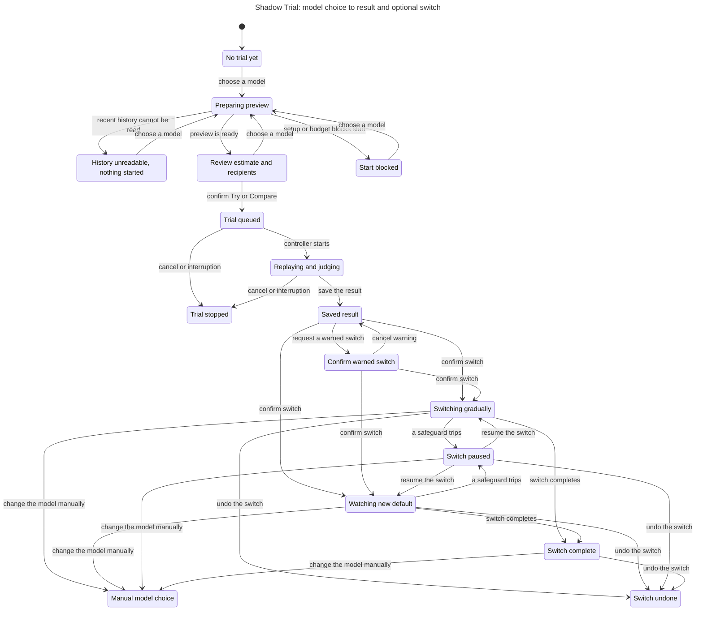

# Shadow Trial statechart

The chart covers the installed `shadow-trial` Desktop journey from choosing a model to reviewing a saved result. A result from **Try** can lead to a switch. A **Compare** result cannot. The model represents one trial and at most one switch, not every path into the plugin.



## What the check found

**The preview must reach a decision.** After you choose a valid model, Shadow shows the consent card or names what blocks it. TLC checked this rule with the other three and found no counterexample in the bounded model.

An earlier version of this model had a "history export times out" step that ended in an unexplained error, and TLC's shortest counterexample was: choose a model, then the export times out. That matched the shipped behavior. The [profile source](../../shadow/desktop_source.py) waited for a host-wide redacted export, and selection rescanned each conversation's history for every turn. On a synthetic 80,000-message week this took about 55 seconds, close to the 60-second export deadline. Now [`export_sessions`](../../shadow/trial/picking.py) redacts only the fields Shadow keeps, selection scrubs each message once, and a failed or slow history read returns a named reason with nothing queued. The [preview check](../../.cursor/skills/verify-shadow/features/trial-preview.md) covers both outcomes.

TLC also checked that no trial queues without consent, a Compare result does not switch, and a warned switch requires an explicit override. These rules hold in the bounded model. They do not prove the running app satisfies them.

## Source boundaries

| Decision | Source | Runtime check |
| --- | --- | --- |
| Prepare and block a preview, refresh stale consent | [`build_start` and `act`](../../shadow/desktop_rpc.py#L1090-L1283) | [Trial preview](../../.cursor/skills/verify-shadow/features/trial-preview.md) |
| Queue, run, stop, and save a result | [`ProfileSource.act`](../../shadow/desktop_source.py#L146-L190), [`TrialEngine.step`](../../shadow/trial/engine.py#L420-L526) | [Desktop fixture journey](../../.cursor/skills/verify-shadow/features/desktop-page.md), [saved results](../../.cursor/skills/verify-shadow/features/saved-results.md) |
| Confirm, pause, resume, undo, or take manual control | [`Engine.start`](../../shadow/switch/engine.py#L67-L103), [`Engine.resume` and `undo`](../../shadow/switch/engine.py#L519-L578) | [Desktop fixture journey](../../.cursor/skills/verify-shadow/features/desktop-page.md) |

The model groups setup and budget blocks and assumes switch compatibility checks pass on shown switch paths. It omits exact timers, replay tool calls, provider traffic, saved-record actions, partial failures, concurrent requests, default-write transitions, and direct CLI switching without a trial. The chart hides self-transitions for re-reviewing changed estimates and for terminal states. Judge selection, timing, permissions, and provider identity still need the real verification recipes.

## Regenerate

Copy `Shadow.tla`, `Shadow.cfg`, and `view.mjs` to a scratch directory. Set `STATECHART` to the absolute path of the installed pstack `statechart/scripts/statechart.ts`. Run this command in that scratch directory with a fresh output directory:

```sh
bun "$STATECHART" Shadow.tla --config Shadow.cfg --view view.mjs --out ./output
```

Expect exit `0` with every rule holding. Read `report.md` and `chart.mmd`. Update the diagram on this page when the transitions change.
